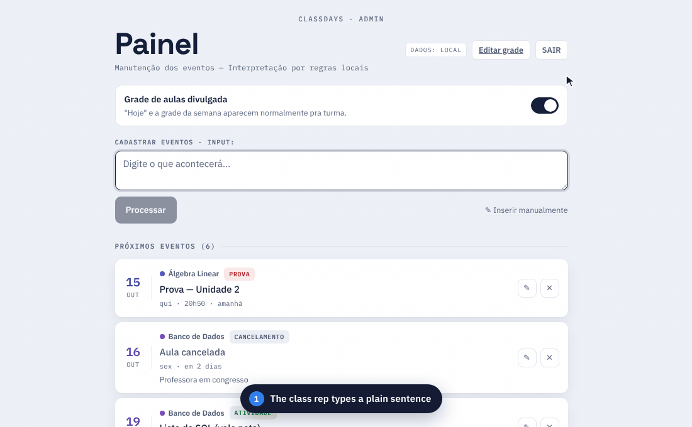

<picture>
  <source media="(prefers-color-scheme: dark)" srcset="assets/banner-en-dark.svg">
  
</picture>

  
  
  
  

<a href="https://github.com/matias-lucas">Português</a> | <b>English</b>

## About me

I study Software Engineering at the **Federal Institute of Goiás (IFG)** in Brazil, currently in my 4th semester. I also work as a **notary clerk** at a registry office and handle the **finances of two land subdivisions**.

That routine is where my projects come from: when a process is repetitive, confusing or easy to get wrong, I try to turn it into software. Classdays started as a way to organize my class schedule; the payment slip automation, as a way to stop settling payments by hand.

I use AI (Claude Code) in my day-to-day development. It speeds up writing code. My part is understanding the problem, defining the business rules, reviewing what goes in and testing before anything ships.

**I'm looking for a web development internship.** If your team has an opening, let's talk.

## Featured project: Classdays

**[Classdays](https://classdays.net)** is a class's academic calendar behind one public link: weekly classes, exams, deadlines and cancellations, easy to read on a phone. Whoever updates it doesn't have to fill in a form: they type a sentence in Portuguese, such as *"na próxima terça não haverá aula de banco de dados"* (no Database class next Tuesday), and the app turns it into an event.

<picture>
  <source media="(prefers-color-scheme: dark)" srcset="assets/classdays-demo-en-dark.gif">
  
</picture>

- **Natural language input:** the sentence goes to the Claude API with *structured outputs*, so the schema guarantees the shape of the response. Without an API key, a rule-based Portuguese parser takes over.
- **Nothing is saved unreviewed:** every event goes through an editable preview before it reaches the database.
- **Built for the class:** no login to check the schedule, light and dark themes, AA contrast, keyboard navigation and 44 px touch targets.
- **245 automated tests** covering relative dates, cancellations, holidays and the parser.

**Stack:** Next.js 16, React 19, TypeScript, Supabase (Postgres with RLS), Claude API and Vercel.

**[Open Classdays](https://classdays.net)** | [View the code](https://github.com/matias-lucas/Classdays)

## Other projects

**[Matias Imóveis website](https://github.com/matias-lucas/matiasimoveis-site)** *(in development)* 
Website for a real estate agency in Itaberaí, Goiás: property search with filters, WhatsApp contact that already names the listing, and a panel where brokers upload photos and videos. Next.js, TypeScript and Supabase.

**Payment slip automation** *(in use, private repository)* 
A Windows program used by both land subdivisions: it reads the bank statement, calculates interest and late fees and settles each payment in the billing system, always with an on-screen review before confirming. It was built with AI from the business rules I gathered at work.

**[proj_algb](https://github.com/matias-lucas/proj_algb)** *(academic project, discontinued)* 
A pair project for my Linear Algebra course, written in C: it reads, solves and classifies linear systems (unique, infinite or no solution) and saves them to a file.

## Stack

<picture>
  <source media="(prefers-color-scheme: dark)" srcset="assets/stack-dark.svg">
  
</picture>

## Activity

<picture>
  <source media="(prefers-color-scheme: dark)" srcset="https://raw.githubusercontent.com/matias-lucas/matias-lucas/output/stats-en-dark.svg">
  
</picture>

<picture>
  <source media="(prefers-color-scheme: dark)" srcset="https://raw.githubusercontent.com/matias-lucas/matias-lucas/output/snake-dark.svg">
  
</picture>

Both are generated daily by a [GitHub Action](https://github.com/matias-lucas/matias-lucas/blob/main/.github/workflows/profile-stats.yml) in this repository, with no external services involved.

---

Looking for a web development internship and happy to talk about automation and software for real-world problems. 
The quickest way to reach me is on <a href="https://linkedin.com/in/matiaslucas">LinkedIn</a> or by <a href="mailto:lucasmatiias2208@gmail.com">email</a>.

