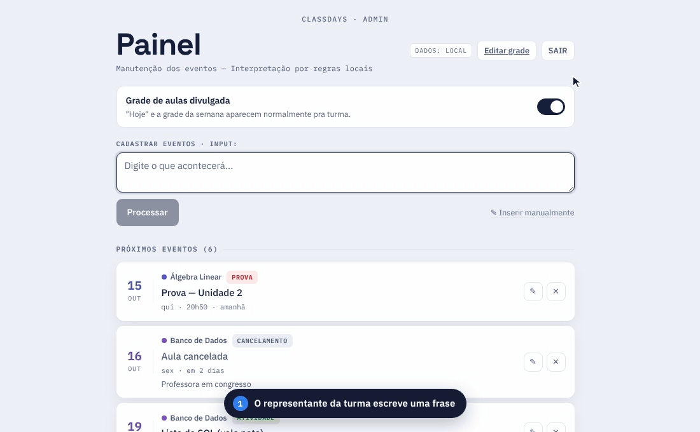
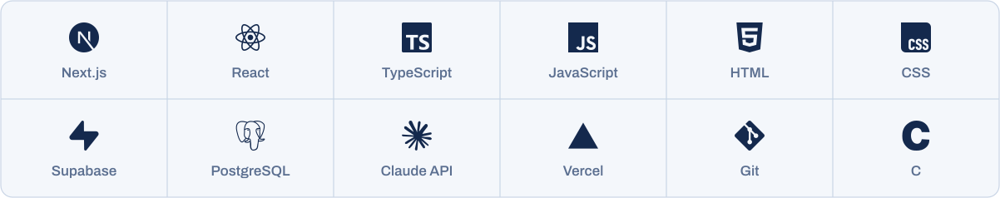

<picture>
  <source media="(prefers-color-scheme: dark)" srcset="assets/banner-pt-dark.svg">
  
</picture>

  
  
  
  

<b>Português</b> | <a href="https://github.com/matias-lucas/matias-lucas/blob/main/README.en.md">English</a>

## Sobre mim

Estudo Engenharia de Software no **Instituto Federal de Goiás (IFG)**, hoje no 4º período. Também trabalho como **escrevente extrajudicial** em cartório e na **gestão financeira de dois loteamentos**.

É dessa rotina que saem os meus projetos: quando um processo é repetitivo, confuso ou fácil de errar, tento transformá-lo em software. O Classdays nasceu para organizar a agenda da minha turma; a automação de boletos, para acabar com as baixas manuais nos loteamentos.

Uso IA (Claude Code) no meu dia a dia de desenvolvimento. Ela acelera a escrita do código. A minha parte é entender o problema, definir as regras de negócio, revisar o que entra e testar antes de publicar.

**Estou procurando estágio em desenvolvimento web.** Se a sua equipe tem uma vaga, vamos conversar.

## Projeto em destaque: Classdays

O **[Classdays](https://classdays.net)** é o calendário acadêmico da turma em um link público: aulas da semana, provas, entregas e cancelamentos, fáceis de ler no celular. Quem cadastra não precisa preencher formulário: escreve uma frase, como *"na próxima terça não haverá aula de banco de dados"*, e o sistema transforma em evento.

<picture>
  <source media="(prefers-color-scheme: dark)" srcset="assets/classdays-demo-pt-dark.gif">
  
</picture>

- **Linguagem natural:** a frase vai para a API do Claude com *structured outputs*, e o schema garante o formato da resposta. Sem chave configurada, um parser de regras em português assume.
- **Nada entra sem revisão:** todo evento passa por um preview editável antes de chegar ao banco.
- **Feito para a turma:** sem login para consultar, tema claro e escuro, contraste AA, navegação por teclado e alvos de toque de 44 px.
- **245 testes automatizados** cobrindo datas relativas, cancelamentos, feriados e o parser.

**Stack:** Next.js 16, React 19, TypeScript, Supabase (Postgres com RLS), API do Claude e Vercel.

**[Abrir o Classdays](https://classdays.net)** | [Ver o código](https://github.com/matias-lucas/Classdays)

## Outros projetos

**[Site da Matias Imóveis](https://github.com/matias-lucas/matiasimoveis-site)** *(em desenvolvimento)* 
Site de uma imobiliária de Itaberaí (GO): busca de imóveis com filtros, contato direto pelo WhatsApp já com o imóvel na mensagem e painel para os corretores cadastrarem fotos e vídeos. Next.js, TypeScript e Supabase.

**Automação de baixa de boletos** *(em uso, repositório privado)* 
Programa para Windows usado nos dois loteamentos: lê o extrato do banco, calcula juros e multa e dá baixa no sistema de cobrança, sempre com uma conferência na tela antes de confirmar. Foi desenvolvido com IA a partir das regras de negócio que levantei no trabalho.

**[proj_algb](https://github.com/matias-lucas/proj_algb)** *(projeto acadêmico, descontinuado)* 
Trabalho em dupla da disciplina de Álgebra Linear, em C: lê, resolve e classifica sistemas lineares (SPD, SPI ou SI) e guarda os sistemas em arquivo.

## Stack

<picture>
  <source media="(prefers-color-scheme: dark)" srcset="assets/stack-dark.svg">
  
</picture>

## Atividade

<picture>
  <source media="(prefers-color-scheme: dark)" srcset="https://raw.githubusercontent.com/matias-lucas/matias-lucas/output/stats-pt-dark.svg">
  
</picture>

<picture>
  <source media="(prefers-color-scheme: dark)" srcset="https://raw.githubusercontent.com/matias-lucas/matias-lucas/output/snake-dark.svg">
  
</picture>

Os dois quadros são gerados todo dia por uma [GitHub Action](https://github.com/matias-lucas/matias-lucas/blob/main/.github/workflows/profile-stats.yml) neste repositório, sem depender de serviços externos.

---

Procurando estágio em desenvolvimento web e aberto a conversar sobre automação e software para problemas reais. 
O jeito mais rápido de falar comigo é pelo <a href="https://linkedin.com/in/matiaslucas">LinkedIn</a> ou por <a href="mailto:lucasmatiias2208@gmail.com">e-mail</a>.

